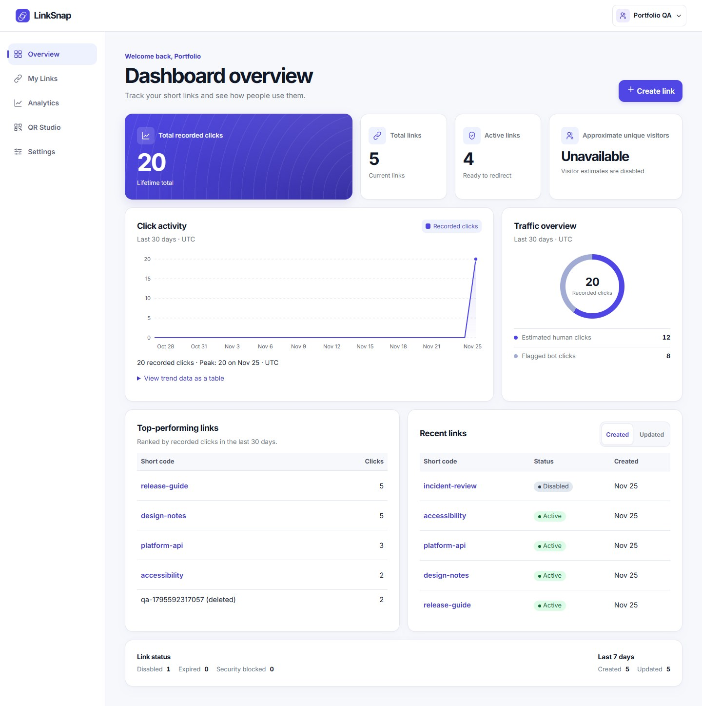
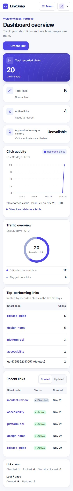
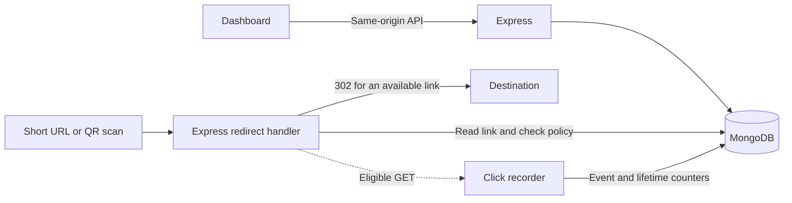

# LinkSnap

LinkSnap is a full-stack link management application. Create a short link, share it as a URL or QR code, and see which visits it receives. One Express service serves the React dashboard, authenticates owners, enforces moderation decisions, and resolves public short links.

The live demo runs the published release. The **Modern Bento** screenshots below show the release candidate running locally on `ui-bento-redesign`. [Open the live demo](https://linksnap-kp8w.onrender.com)

## Features

| Area | What you can do |
| --- | --- |
| Links | Create random short codes or custom aliases. Set expiration, enable or disable links, add tags, search and filter, and apply bulk actions. |
| Dashboard | Review link totals, seven-day activity, and recently created and updated links. |
| Analytics | Explore UTC trends and device, browser, OS, country, and referrer breakdowns. Filter traffic and export up to 5,000 matching events as CSV. |
| QR Studio | Adjust colors and size, add a logo, preview the code, and export PNG or SVG. Each export encodes the canonical short URL. |
| Accounts | Register, log in, update your display name, change your password, or revoke active sessions. |
| Safety | Preview a destination hostname, report abuse, and use the admin queue to review reports or block links. |

## Inside the dashboard

The overview brings lifetime counters, the selected activity window and link status into one workspace. Both screenshots show disposable local QA links and clicks generated by test redirect requests.



<details>
<summary>See the mobile dashboard</summary>



</details>

## Architecture and stack

The frontend uses **React, React Router, Vite and Vanilla CSS**, with Recharts for trends and browser-side QR generation. **Node.js and Express** serve the frontend build, JSON API and redirects on the same production origin. **Mongoose and MongoDB** store accounts, sessions, links, click events and moderation reports. [Architecture](docs/ARCHITECTURE.md) · [Database models](docs/DATABASE.md)



**Account workflow.** Registration or login issues a short-lived access token held in memory and a rotating HttpOnly refresh cookie. On reload the browser uses the cookie to restore the session. Password changes and logout-all revoke sessions across devices. Protected requests check the session on the server, and moderation also requires the admin role.

**Link workflow.** The owner submits a destination and an optional alias. A unique index protects the short code. Each visit checks expiration, enabled state, deletion, moderation and destination policy before redirecting. Eligible clicks are recorded asynchronously. The dashboard queries those records by UTC date range, traffic class or link. QR preview and download leave the click count unchanged.

```text
client/                 React pages, layouts, components, services, styles, and tests
server/                 Express modules, Mongoose models, and API integration tests
docs/                   Architecture, database, API, and testing documentation
.github/workflows/      GitHub Actions verification
```

## Run locally

Install Git, Node.js **22.13 or newer** (CI uses Node.js 22), npm, and a local MongoDB instance. Use MongoDB 8 to match CI, or configure a separate Atlas development database using the [server guide](server/README.md#mongodb-atlas).

```sh
git clone https://github.com/krishbajaj0/LinkSnap.git
cd LinkSnap
npm ci --prefix client
npm ci --prefix server
```

Copy [server/.env.example](server/.env.example) to `server/.env` if the file does not exist. Set `MONGODB_URI` to your local MongoDB connection string with a development database name. With default local MongoDB settings, use the host `127.0.0.1`, port `27017`, and a database such as `linksnap_dev`. Set `AUTH_SECRET` to a locally generated 32-byte hex value using the [server setup instructions](server/README.md#authentication). Keep completed environment files private.

Run these commands in separate terminals from the repository root:

```sh
npm run dev --prefix server
npm run dev --prefix client
```

Open [the local app](http://localhost:5173). The API defaults to port 3000, with [liveness](http://127.0.0.1:3000/api/v1/health) and [database readiness](http://127.0.0.1:3000/api/v1/health/ready) checks.

| Setting | Purpose |
| --- | --- |
| Server `NODE_ENV`, `HOST`, `PORT` | Environment and listener address. The local defaults are `development`, `127.0.0.1`, and `3000`. |
| Server `MONGODB_URI`, `AUTH_SECRET` | MongoDB connection and signing secret. Both are needed for local account and link features. |
| Server `CLIENT_ORIGINS` | Exact comma-separated frontend origins for credentialed CORS and trusted writes. Defaults to the two Vite loopback origins. |
| Server `ANALYTICS_VISITOR_SECRET`, `ANALYTICS_GEOIP_PATH` | Optional separate hex key for daily visitor estimates and local MaxMind database path for country attribution. |
| Server `TRUSTED_PROXY_IPS`, `TRUST_RENDER_EDGE` | Optional exact trusted proxy addresses or verified Render public-edge mode. The modes are mutually exclusive. Edge mode defaults to false and requires an edge-only ingress trust boundary. |
| Server `PROHIBITED_LINK_DOMAINS` | Optional operator-maintained destination domain blocklist. |
| Client `LINKSNAP_API_TARGET` | Local Vite proxy override. Defaults to the loopback API on port 3000. |
| Client `VITE_PUBLIC_BASE_URL` | Public HTTPS short-link origin baked into the build. Render builds default to `RENDER_EXTERNAL_URL`. Development can use loopback. Only public values belong in Vite variables. |

## Security and privacy

- **Sessions.** A 15-minute access JWT lives in React memory. A rotating HttpOnly refresh cookie has a fixed seven-day session lifetime. Protected routes check active sessions and read admin roles on the server. Auth and admin writes require a trusted origin and a CSRF header.
- **Analytics.** The recorder stores coarse device, browser, OS, country and referrer-domain data. Raw IP addresses and full headers are excluded from stored click records. Optional daily, owner-scoped visitor identifiers produce estimates. MongoDB expires event records after 90 days, while lifetime counters remain on the link.
- **Moderation.** URL checks evaluate address patterns and locally configured prohibited domains. Public reports are rate-limited and deduplicated. Admin decisions have an audit history. Blocks apply to the canonical redirect, including QR scans. [Admin setup](server/README.md#bootstrap-the-first-admin)
- **QR Studio.** Logos are read and validated in the browser. Preview and exports use the same QR symbol. Low contrast disables export, and previewing a code does not record a click. [QR setup](client/README.md)

## API, scripts, and testing

[API usage and Postman setup](docs/API.md) · [OpenAPI specification](docs/openapi.json) · [Automated and manual test guide](docs/TESTING.md)

For deployment, build the client, run the Express service against its dedicated Atlas database, then verify liveness and database readiness. The Render blueprint tracks `main` with automatic deployment off. Record the previous deploy before manually releasing a CI-verified SHA. [Render and MongoDB Atlas setup](docs/DEPLOYMENT.md) · [Bento release checklist](docs/REDESIGN-RELEASE.md)

| Command | Purpose |
| --- | --- |
| `npm run dev --prefix client` | Start Vite with hot reload. |
| `npm run lint --prefix client` | Run ESLint. |
| `npm test --prefix client` | Run frontend JavaScript tests. |
| `npm run build --prefix client` | Build production assets into `client/dist`. |
| `npm run preview --prefix client` | Preview built frontend assets locally. Use the dev server for the documented API proxy. |
| `npm run dev --prefix server` | Start Express in watch mode. |
| `npm start --prefix server` | Start Express without file watching. |
| `npm test --prefix server` | Run API and security regression tests against isolated local test databases. |

## Limitations and next steps

Analytics writes are best effort. A process restart, write failure, or burst can drop events, and event counts and lifetime totals can diverge. Country is `Unknown` without a usable GeoIP result. URL checks are heuristic and do not fetch or verify destinations. Rate-limit counters are local to each API process.

Human and bot classifications are estimates. Click events expire after 90 days and a CSV download contains at most 5,000 matching events. The QR chooser shows the ten most recent links. Older links are available through My Links. The Render Free service can take time to wake up after inactivity.
