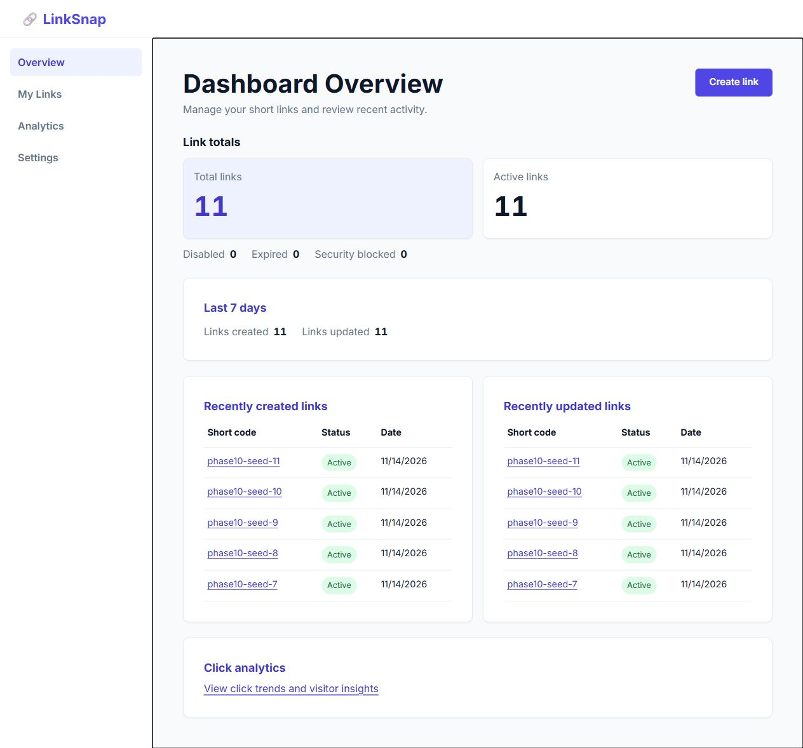

# LinkSnap

LinkSnap is a full-stack URL shortener for creating, organizing, and monitoring short links. It combines a React dashboard with an Express API and MongoDB for link data, accounts, and click analytics.

**Repository** · [krishbajaj0/LinkSnap](https://github.com/krishbajaj0/LinkSnap)

## Features

| Area | What you can do |
| --- | --- |
| Links | Create random short codes or custom aliases. Set expiration, enable or disable links, add tags, search and filter, and apply bulk actions. |
| Dashboard | Review link totals, seven-day activity, and recently created and updated links. |
| Analytics | Explore UTC trends and device, browser, OS, country, and referrer breakdowns. Filter traffic and export up to 5,000 matching events as CSV. |
| QR Studio | Adjust colors and size, add a logo, preview the code, and export PNG or SVG. Each export encodes the canonical short URL. |
| Accounts | Register, log in, update your display name, change your password, or revoke active sessions. |
| Safety | Preview a destination hostname, report abuse, and use the admin queue to review reports or block links. |

## Screenshots



Dashboard Overview captured from a local test database using sample links. To reproduce it, run the app locally, create a few sample links, and open **Dashboard Overview**.

## Architecture and stack

The frontend uses **React, React Router, Vite, and Vanilla CSS**. An **Express** API serves JSON, CSV, health checks, and short redirects. **Mongoose** models persist accounts, sessions, links, click events, and reports in **MongoDB**. Vite proxies API and short-link requests locally. [Architecture](docs/ARCHITECTURE.md) · [Database models](docs/DATABASE.md)

```text
client/                 React pages, layouts, components, services, styles, and tests
server/                 Express modules, Mongoose models, and API integration tests
docs/                   Architecture, database, API, and testing documentation
.github/workflows/      GitHub Actions verification
```

## Run locally

Install Git, Node.js **22.13 or newer** (CI uses Node.js 22), npm, and a local MongoDB instance. Use MongoDB 8 to match CI, or configure a separate Atlas development database using the [server guide](server/README.md#mongodb-atlas).

```sh
git clone https://github.com/krishbajaj0/LinkSnap.git
cd LinkSnap
npm ci --prefix client
npm ci --prefix server
```

Copy [server/.env.example](server/.env.example) to `server/.env` if the file does not exist. Set `MONGODB_URI` to your local MongoDB connection string with a development database name. With default local MongoDB settings, use the host `127.0.0.1`, port `27017`, and a database such as `linksnap_dev`. Set `AUTH_SECRET` to a locally generated 32-byte hex value using the [server setup instructions](server/README.md#authentication). Keep completed environment files private.

Run these commands in separate terminals from the repository root:

```sh
npm run dev --prefix server
npm run dev --prefix client
```

Open [the local app](http://localhost:5173). The API defaults to port 3000, with [liveness](http://127.0.0.1:3000/api/v1/health) and [database readiness](http://127.0.0.1:3000/api/v1/health/ready) checks.

| Setting | Purpose |
| --- | --- |
| Server `NODE_ENV`, `HOST`, `PORT` | Environment and listener address. The local defaults are `development`, `127.0.0.1`, and `3000`. |
| Server `MONGODB_URI`, `AUTH_SECRET` | MongoDB connection and signing secret. Both are needed for local account and link features. |
| Server `CLIENT_ORIGINS` | Exact comma-separated frontend origins for credentialed CORS and trusted writes. Defaults to the two Vite loopback origins. |
| Server `ANALYTICS_VISITOR_SECRET`, `ANALYTICS_GEOIP_PATH` | Optional separate hex key for daily visitor estimates and local MaxMind database path for country attribution. |
| Server `TRUSTED_PROXY_IPS`, `PROHIBITED_LINK_DOMAINS` | Optional exact proxy addresses and operator-maintained destination domains. |
| Client `LINKSNAP_API_TARGET` | Local Vite proxy override. Defaults to the loopback API on port 3000. |
| Client `VITE_PUBLIC_BASE_URL` | Public HTTPS short-link origin for production QR Studio, set before the frontend build. Local loopback works in dev. |

## Security and privacy

- **Sessions.** A 15-minute access JWT lives in React memory. A rotating HttpOnly refresh cookie has a fixed seven-day session lifetime. Protected routes check active sessions and read admin roles on the server. Auth and admin writes require a trusted origin and a CSRF header.
- **Analytics.** The recorder stores coarse device, browser, OS, country and referrer-domain data. Raw IP addresses and full headers are excluded from stored click records. Optional daily, owner-scoped visitor identifiers produce estimates. MongoDB expires event records after 90 days, while lifetime counters remain on the link.
- **Moderation.** URL checks evaluate address patterns and locally configured prohibited domains. Public reports are rate-limited and deduplicated. Admin decisions have an audit history. Blocks apply to the canonical redirect, including QR scans. [Admin setup](server/README.md#bootstrap-the-first-admin)
- **QR Studio.** Logos are read and validated in the browser. Preview and exports use the same QR symbol. Low contrast disables export, and previewing a code does not record a click. [QR setup](client/README.md)

## API, scripts, and testing

[API usage and Postman setup](docs/API.md) · [OpenAPI specification](docs/openapi.json) · [Automated and manual test guide](docs/TESTING.md)

| Command | Purpose |
| --- | --- |
| `npm run dev --prefix client` | Start Vite with hot reload. |
| `npm run lint --prefix client` | Run ESLint. |
| `npm test --prefix client` | Run frontend JavaScript tests. |
| `npm run build --prefix client` | Build production assets into `client/dist`. |
| `npm run preview --prefix client` | Preview built frontend assets locally. Use the dev server for the documented API proxy. |
| `npm run dev --prefix server` | Start Express in watch mode. |
| `npm start --prefix server` | Start Express without file watching. |
| `npm test --prefix server` | Run API and security regression tests against isolated local test databases. |

## Limitations and next steps

Analytics writes are best effort. A process restart, write failure, or burst can drop events, and event counts and lifetime totals can diverge. Country is `Unknown` without a usable GeoIP result. URL checks are heuristic and do not fetch or verify destinations. Rate-limit counters are local to each API process.

Potential improvements include durable analytics processing, shared rate limits for multi-instance hosting, and automated browser coverage. Phase 11 covers local setup, documentation, tests, and CI. A public production deployment is outside this phase.
