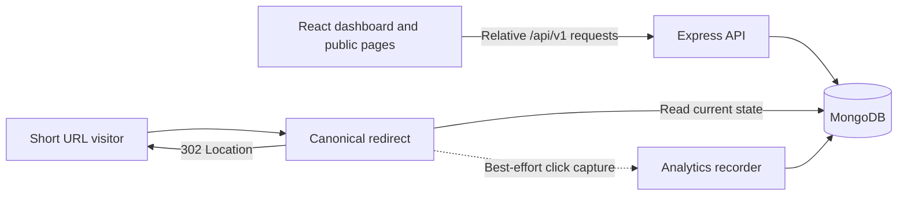

# LinkSnap architecture

## Frontend and backend

React Router maps public landing, auth, preview and report screens, plus the protected dashboard. Dashboard pages share a layout and authentication context. Analytics, QR Studio and moderation load on demand. The client uses relative API URLs and sends access tokens in the Authorization header. Vite proxies requests locally to Express, including recognized short-code paths.

Express mounts health, auth, links, analytics, public safety and admin routers. Helmet, explicit CORS, body limits and API rate limiting run before route handlers. Central error handling returns a consistent JSON envelope, including sanitized unexpected errors. Mongoose models connect accounts and sessions to links, click events and reports. [Collection definitions](DATABASE.md)

## Authentication and redirect lifecycle

Registration or login creates a session and returns a 15-minute access JWT plus an HttpOnly refresh cookie. The React provider holds the access token in memory and uses the cookie to restore the session on reload. Refresh atomically rotates the cookie within the original seven-day lifetime. The API checks the current session and user version for protected requests. Logout revokes one session. Password changes and logout-all revoke active sessions by advancing the version. Moderation checks the role from the database.

New links use an eight-character Nano ID or a validated custom alias. The unique short-code index arbitrates concurrent claims. Automatic codes retry collisions up to five attempts. Soft deletion keeps the alias reserved. A public request reads the current record from the primary and checks enabled state, expiration, deletion, block state and destination policy before responding. Destination checks parse URLs locally. Preview uses the same policy, with Continue routed through the canonical path.

## Analytics, QR and moderation

After sending an eligible GET redirect, Express schedules background recording. HEAD and explicit prefetch/prerender requests skip recording. Metadata is reduced to coarse dimensions. Optional visitor estimates use a daily owner-scoped digest. The recorder inserts the event and then increments lifetime counters in a separate operation. In-flight work is capped at 64 jobs per process. A restart can lose pending jobs, saturation can drop events, and a failed counter update can leave a reportable event without a matching lifetime increment. There is no durable queue.

QR Studio generates the preview, SVG and PNG from the same canonical URL and settings in the browser. Logo validation and rendering happen locally. Previewing the QR does not request the short URL.

Public report submissions are limited and deduplicated. The response gives the same acknowledgment for a normal, duplicate, honeypot or unknown-code submission that passes input validation. Admins can change report status or separately review, block and unblock a link. Each decision and its audit entry update the same MongoDB document together.

## Environment boundaries

Local development uses Vite and the loopback API. A future production host needs an HTTPS origin, static asset serving, known React-route fallback, and forwarding for `/api` and canonical short URLs. Handle short URLs before applying a generic SPA fallback. Reserve new top-level app routes so they do not collide with aliases. Configure the production QR origin before building assets. The API requires production secrets, an explicit origin allowlist, and an initial MongoDB connection. Proxy trust should include only controlled proxy IPs. Production infrastructure is outside Phase 11.
